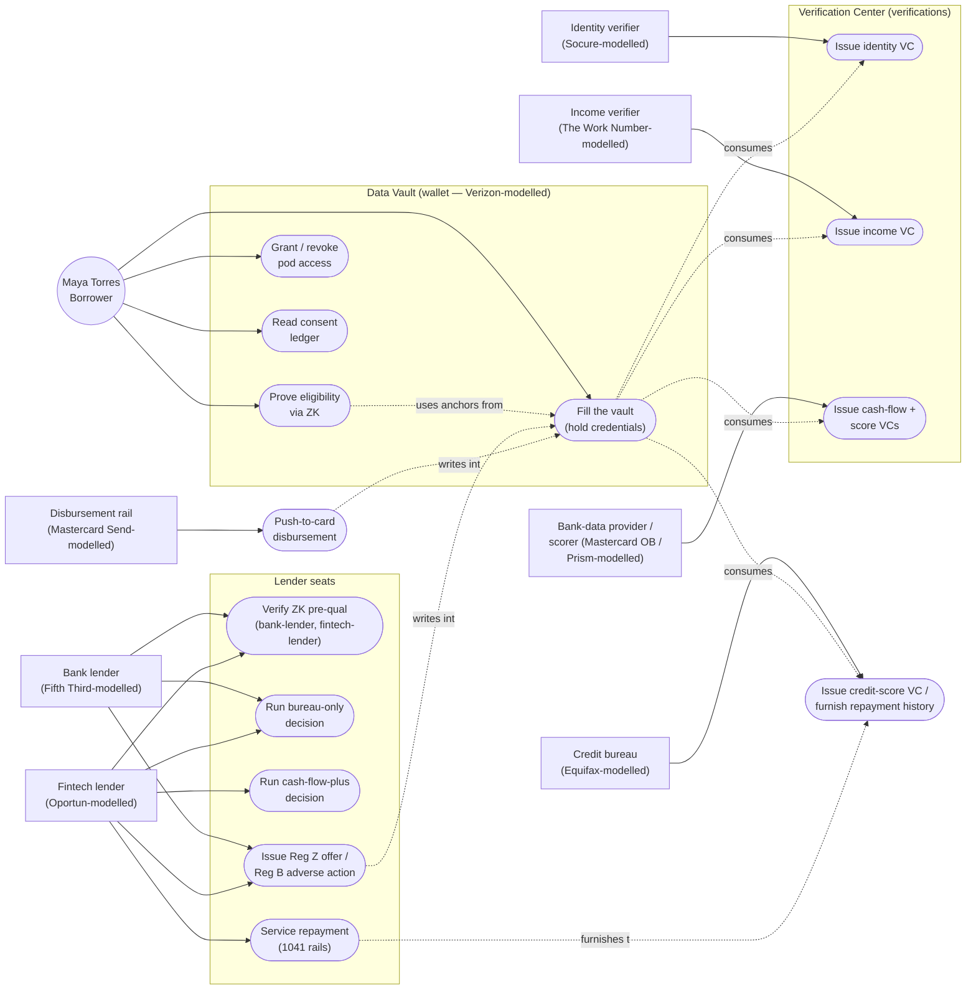
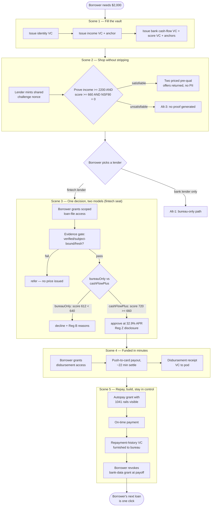

# Use Case: Inclusive Small-Dollar Lending Through a Borrower-Held Data Vault

> Concept demonstration — not affiliated with or endorsed by Fifth Third Bank, Oportun,
> Equifax, Mastercard, Socure, Prism Data, Verizon, GLEIF, EDMA/OMG, FDX, or the CFPB. Every
> organisation named below is referenced illustratively ("modelled on") to ground the
> use case in a real market role; no branded surface in the underlying repository claims
> to be, or to speak for, the named organisation. All personas, account numbers, and
> figures are simulated demo data — no real PII.
>
> This document follows the OMG / EDM Council use-case template (the standard EDMA UC
> format), filled from `jeswr/solid-lending`'s committed research and code — nothing
> below is invented. Every quantified market fact is cited to
> `docs/research/small-dollar-lending-sources.md`'s numbered index (carried in the
> `solid-mortgage` monorepo alongside the design of record,
> `docs/research/small-dollar-lending-design.md`, hereafter "the design doc"); every
> credential/IRI/threshold claim is cited to the file in this repo that defines it.

## I. Use Case Description

| Field | Value |
|---|---|
| **Use Case Name** | Inclusive Small-Dollar Lending Through a Borrower-Held Data Vault |
| **Use Case Identifier** | SOLID-LEND-01 |
| **Source** | EDMA Solid Community of Practice — Small-Dollar Lending Showcase ("Demo 2"), `jeswr/solid-lending` |
| **Point of Contact** | Jesse Wright <63333554+jeswr@users.noreply.github.com> |
| **Creation / Revision Date** | 2026-07-22 |
| **Associated Documents** | `docs/research/small-dollar-lending-design.md` (design of record, §§1–9); `docs/research/small-dollar-lending-sources.md` (citation index); `docs/zk-plan.md` (ZK scope/implementation seam note); `packages/data-model/vocab/lend.ttl` (project residue vocabulary); `packages/data-model/shapes/*.ttl` (10 SHACL credential/receipt shapes); bead `sm-vcoz` |

## II. Use Case Summary

### Goal

Give a thin-file or near-prime borrower a single, borrower-controlled data vault (a
Solid pod) that lets them prove eligibility and share verified income, identity, and
bank cash-flow data with competing lenders **once**, so that a $2,000 personal
installment loan can be shopped, decisioned, funded, and repaid without re-surrendering
identity and financial history to every lender in the funnel — and so that a lender
willing to underwrite on cash-flow data, not bureau data alone, can *see* an
otherwise-invisible borrower's actual ability to repay and approve where a
bureau-only competitor declines.

### Requirements

- R1 — A borrower must be able to accumulate issuer-signed, W3C VC 2.0 identity,
  employment/income, and bank cash-flow credentials in a pod they control (design doc
  §4.1–§4.2; `packages/data-model/shapes/identity-credential.ttl`,
  `employment-income-credential.ttl`, `bank-cashflow-credential.ttl`).
- R2 — A borrower must be able to prove three eligibility predicates — net monthly
  income ≥ $2,200, cash-flow score ≥ 660, NSF events in the trailing 90 days = 0 — to
  multiple lenders via zero-knowledge proof, disclosing no PII and leaving no copy
  behind, during shopping/pre-qualification (design doc §4.5, §6 scene 2;
  `packages/data-model/src/personas.ts::ZK_PREQUAL_THRESHOLDS`;
  `packages/vc-kit/src/zk/circuits/registry.ts`).
- R3 — Once a lender is chosen, the same evidence must be re-presentable as scoped,
  revocable pod grants (not re-collected), and two independent decisioning rails —
  bureau-only and cash-flow-plus — must run over the SAME evidence set so the
  inclusion effect is demonstrable side by side (`apps/fintech-lender/lib/server/underwriting.ts::runTwoModelDecision`;
  `apps/bank-lender/lib/server/underwriting.ts::runBureauOnlyDecision`).
- R4 — A decline must carry ECOA/Reg B principal reasons (12 CFR §1002.9) and an
  approval must carry TILA/Reg Z closed-end disclosures (APR, finance charge, total of
  payments, payment schedule — 12 CFR §§1026.17–18) written into the pod
  (`apps/bank-lender/lib/server/adverse-action.ts`; `lend:hasFinanceCharge`,
  `lend:hasTotalOfPayments` in `packages/data-model/vocab/lend.ttl`).
- R5 — Funding must be demonstrable on an instant rail (push-to-card, ≤30 minutes) with
  a signed receipt landing back in the pod (`apps/disbursement/lib/server/service.ts`
  payout flow; design doc §6 scene 4, source [29]).
- R6 — Repayment authorization must be an inspectable, revocable ODRL grant with the
  CFPB's 12 CFR 1041 payment-provision rail (no third withdrawal attempt after two
  consecutive failures without fresh authorization) rendered in code, not just prose
  (`apps/fintech-lender/lib/server/servicing.ts`).
- R7 — On-time repayment must be furnishable back to the bureau seat as a reusable
  credit-building credential — the graduation beat (`lend:RepaymentHistoryCredential`;
  `apps/bureau/app/api/furnish/route.ts`).
- R8 — Every grant and revocation must write a DPV consent receipt the borrower can
  read (`packages/data-model/shapes/consent-receipt.ttl`;
  `apps/wallet/app/api/ledger/route.ts`).

### Scope

**In scope**: the borrower-facing pod/vault experience; three issuer flows (identity,
income, bank cash-flow + cash-flow score); ZK pre-qualification against two competing
lenders; the two-model (bureau-only vs. cash-flow-plus) origination decision at one
fintech lender and the bureau-only decision at one bank lender; Reg Z/Reg B disclosure
generation; push-to-card disbursement; repayment servicing with 12 CFR 1041 rails;
bureau furnishing of repayment history; the consent/grant/revocation ledger. All flows
run against `@jeswr/solid-server` (sparq's WASM Solid server), not a production bank,
lender, or bureau system.

**Out of scope** (would be in scope for a real partner build): actual movement of
money (the push-to-card rail is deterministically simulated —
`apps/disbursement/lib/server/service.ts`); real underwriting risk models (the
threshold engines in `underwriting.ts` are transparent, illustrative rule sets
standing in for a lender's proprietary scorecard, explicitly documented as such);
real KYC/CIP, real bureau pulls, real bank-account aggregation (Socure/The Work
Number/Mastercard Open Banking/Equifax/Prism are modelled, not integrated); Military
Lending Act 36% MAPR enforcement (cited in the design doc's compliance-lens table §6.4
but not wired into a decisioning gate in the current build); production-grade key
custody, account security, and fraud controls for the pod itself.

### Priority

High within the showcase programme — this is the second of two live EDMA showcases
(after the mortgage showcase) and is the framework's (`create-solid-demo`) first
second-scaffold acceptance test: it must render from walkthrough data alone, without
framework code changes (design doc §8).

### Stakeholders

Twelve ecosystem roles, each modelled on a real US organisation or (for the regulator
role) referenced generically — per design doc §3. Every named organisation carries an
"illustrative — not affiliated with or endorsed by" framing; none of the code in this
repository represents itself as, or is licensed by, the named entity.

| # | Role | Modelled on | Notes |
|---|------|-------------|-------|
| 1 | Borrower data vault | **Verizon** | Consumer-scale data-custodian seat; reused from the mortgage showcase (design doc §3) |
| 2 | Bank installment lender | **Fifth Third Bank** | Real product: $2,000–$50,000 personal loans, next-business-day funding [20] |
| 3 | Cash-flow / mission-driven fintech lender | **Oportun** | $300–$10,000 loans; 1.1M+ no-FICO borrowers started credit histories [11][12] |
| 4 | Credit bureau | **Equifax** | Traditional score + furnishing endpoint; also models roles 5/6's data distribution |
| 5 | Income / employment verification | **Equifax Workforce Solutions (The Work Number)** | 823M+ instant VOIE records [22] |
| 6 | Bank-data aggregator / open banking | **Mastercard (Open Banking / Finicity)** | FDX-shaped cash-flow attribute connection [13] |
| 7 | Cash-flow underwriting analytics | **Prism Data** | CashScore v4: +28% approvals at flat risk [7] |
| 8 | Identity verification & fraud | **Socure** | Consortium of 2,700+ customers, ~2B identities [19] |
| 9 | Disbursement rail | **Mastercard (Mastercard Send)** | Push-to-card, ≤30 min [29] |
| 10 | Servicing / repayment | Self-serviced by the fintech lender (industry norm at this ticket size; LoanPro nodded to as the servicing-core analogue) | No separate app; scene 5 of `fintech-lender` |
| 11 | Data / standards steward | **EDMA/OMG (FIBO)** jointly with **FDX** | FIBO LOAN grounds the RDF loan model [36]; FDX shapes the cash-flow VC payload [13][14] |
| 12 | Organisational identity | **GLEIF** | Stakeholder orgs referenced by LEI (design-level; vLEI is product-phase narrative) |
| — | Regulator lens | **CFPB — represented generically, never impersonated** | Unbranded "Examiner View" over Reg Z, Reg B, 12 CFR 1041, Reg E |

The primary human stakeholder is the borrower (played in this demo by the fictional
persona Maya Torres, §5/§III below). Secondary human stakeholders are loan officers at
each lender seat and a payroll officer at Maya's fictional employer, walked on but not
played (design doc §5).

### Description

A borrower with a thin credit file needs a small, short-term loan and today must
re-surrender identity, income, and bank documents to every lender they shop, while a
bureau-only underwriting model very often prices them out or declines them outright —
even when their actual cash flow shows they can repay. This use case builds a
borrower-held Solid pod ("Data Vault") that accumulates verifiable credentials once
(identity, employment/income, bank cash-flow, cash-flow score, bureau score) and lets
the borrower (1) prove eligibility to multiple lenders with zero-knowledge proofs
during shopping, disclosing no PII; (2) grant one chosen lender scoped, revocable
access to the underlying evidence for a real application; (3) receive, side by side,
a bureau-only decision (decline, with statutory Reg B reasons) and a cash-flow-plus
decision (approve, with Reg Z disclosures) computed over the *same* evidence by two
different lenders; (4) get funded on an instant push-to-card rail; and (5) build a
reusable repayment-history credential while retaining one-click revocation of every
grant. The principal actor is the borrower; the credential issuers and lenders are
secondary actors who read from, and write into, the borrower's pod under scoped,
receipted access.

### Actors / Interfaces

**Primary actor**: the borrower (Maya Torres persona) — initiates every scene, holds
every credential, and controls every grant/revocation via the `wallet` app.

**Secondary actors** (systems/services, external to the use-case owner — detailed
under Resources, §VIII):

| Actor | System role | App |
|---|---|---|
| Identity verifier (Socure-modelled) | Issues the identity VC | `verifications` |
| Income verifier (The Work Number-modelled) | Issues the employment+income VC | `verifications` |
| Bank-data provider (Mastercard Open Banking-modelled) | Issues the bank cash-flow VC | `verifications` |
| Cash-flow scorer (Prism Data-modelled) | Issues the cash-flow score VC, derived from the cash-flow VC | `verifications` |
| Credit bureau (Equifax-modelled) | Issues the credit-score VC; receives furnished repayment history | `bureau` |
| Bank installment lender (Fifth Third-modelled) | ZK pre-qual verifier; bureau-only origination + adverse-action notice | `bank-lender` |
| Fintech installment lender (Oportun-modelled) | ZK pre-qual verifier; two-model origination, servicing, furnishing | `fintech-lender` |
| Disbursement network (Mastercard Send-modelled) | Push-to-card payout + receipt | `disbursement` |
| Compliance lens ("Examiner View") | Unbranded read-only view over Reg Z/Reg B/1041/Reg E rules | `tour` |

Every credential issuer and lender is external to (outside the control of) the
borrower's pod — access is always by scoped grant, never by copy, per the
borrower-controlled-vault design principle (design doc §4.1).

### Pre-conditions

- The borrower's pod exists and is reachable (Mode-1 in-browser pod or a seeded dev
  pod under `@jeswr/solid-server`); the borrower is authenticated with a stable
  Client Identifier Document.
- The three scene-1 issuer flows have completed at least once, so the pod holds a
  valid (non-expired, non-revoked) identity VC, employment+income VC, bank
  cash-flow VC, and cash-flow-score VC (`packages/data-model/src/personas.ts`
  seeds these deterministically for the demo persona).
- Each ZK-provable field (`lend:netMonthlyIncomeUsd`, `lend:cashFlowScoreValue`,
  `lend:nsf90Count`) has an issuer-signed `lend:ZkOperandAnchor` binding its
  deterministic sparq encoding, minted at issuance time
  (`packages/data-model/shapes/zk-operand-anchor.ttl`; `docs/zk-plan.md`).

### Post-conditions

- On a successful journey: the pod holds a `LoanOfferCredential` with Reg Z
  disclosure fields, a `DisbursementReceiptCredential`, an evolving
  `RepaymentHistoryCredential`, and a consent-receipt ledger recording every grant
  and revocation the borrower made.
- On a bureau-only decline: the pod (or the declining lender's own record, per
  `ADVERSE_ACTION_POD_PATH = "/lending/adverse-action"`) holds a Reg B
  adverse-action notice with specific principal reasons.
- At payoff: the borrower has revoked the funding lender's bank-cash-flow grant;
  the revocation is immutable and logged (`apps/wallet/app/api/grants/change/route.ts`).

### Triggers

- **External/temporal**: the borrower's transmission fails and they need $2,000
  within days (the persona's narrative trigger, design doc §5).
- **Internal**: the borrower opens the `wallet` app and initiates a scene-1 issuer
  flow, or a lender's `prequal` route mints a ZK challenge nonce
  (`apps/fintech-lender/app/api/prequal/challenge/route.ts`).

### Performance Requirements

- ZK proof verification is a fail-closed, nine-gate check across three legs sharing
  one lender-minted nonce; structural checks run before the nonce is consumed so a
  malformed presentation never burns a live challenge (`docs/zk-plan.md`).
- Push-to-card disbursement settles in ≤30 minutes in the target rail (design doc
  §2 stage 8, source [29]); the seeded persona fixture settles 22 minutes after
  funding (`packages/data-model/src/personas.ts`).
- Reg B adverse-action notices must be deliverable within the regulatory 30-day
  window (12 CFR §1002.9); this demo delivers synchronously at decision time.
- Vitest suites across apps/packages run with a 30s test timeout (real-crypto and
  pod round-trips exceed the 5s default cold in CI — repo commit history,
  `efad9af`/`53f8323`).

### Assumptions

- Illustrative APR pricing tiers and bureau/cash-flow thresholds
  (`BUREAU_ONLY_THRESHOLDS`, `CASH_FLOW_THRESHOLDS` = `ZK_PREQUAL_THRESHOLDS`) stand
  in for a lender's proprietary scorecard; they are transparent and
  deterministic by design, not calibrated to any real lender's actual policy.
- EDMA membership flags in the stakeholder table are sourced from an internal
  snapshot (4 Jun 2026) and are explicitly flagged in the design doc (§3, gap G1)
  for re-verification before any partner outreach.
- The CashScore-modelled 300–850 range and the persona's 720 value are illustrative
  (design doc gap G3 — Prism's real product sheet was unreachable during research).

### Open Issues

- Synthetic-identity fraud loss figures conflict across sources ($6B Fed-lineage vs.
  $20B+ industry-cited) — design doc gap G2, unresolved; this document cites the
  range, not a single figure.
- No FIBO↔FDX field-mapping document (`docs/fibo-fdx-binding.md`, referenced as the
  demo's standards artifact in design doc §6.2) exists yet in the repository at the
  time of writing — the cash-flow VC's FDX-shape claim currently lives only in
  `rdfs:comment` annotations in `packages/data-model/vocab/lend.ttl`.
- Military Lending Act 36% MAPR (design doc §6.4, `mla-mapr`) is documented as a
  compliance-lens rule but not yet wired into either lender's decisioning code.
- The credit-invisibles headline number is post-correction and *must* use the
  FinRegLab "≈1 in 3 thin/no-file" framing or the corrected CFPB ~7M (2.7%, Dec
  2020) figure — never the retracted 26M/45M (design doc gap G8; sources [8][9]).

## III. Usage Scenarios

All personas below are fictional demo personas (`persona.descriptor` is enforced to
contain "fictional"/"simulated" by the framework's `parseWalkthrough`); no real PII
appears anywhere in this document or the underlying repository.

**Scenario 1 — Maya Torres: the inclusion beat (thin-file, cash-flow approval)**

Maya Torres, 27, a W-2 shift supervisor at the fictional Brightline Staffing LLC in
Columbus, OH, with weekend rideshare income on the side, needs $2,000 within days
after a transmission failure threatens her commute. Her bureau file is thin — 14
months of history, two tradelines, a 612 score — the kind of file that gets declined
or priced out on bureau data alone (design doc §1, §5). Her actual cash flow tells a
different story: $2,860/month in net deposits across two income streams, zero NSF
events in 90 days, a 720 illustrative cash-flow score. She fills her Data Vault once
(scene 1), then proves — via zero-knowledge proof, disclosing nothing — that her
income clears $2,200/mo, her cash-flow score clears 660, and her NSF₉₀ count is
exactly zero, to two competing lenders simultaneously (scene 2). She picks the
fintech lender (Oportun-modelled); its cash-flow-plus rail approves her at 32.9% APR
for an 18-month, $2,000 loan ($142.26/month, $560.68 total finance charge) — the
*same* evidence run through the bank lender's bureau-only rail would decline her for
"limited tradelines" and "insufficient credit history" (scene 3; this is the
demo's signature side-by-side contrast, `apps/fintech-lender/lib/server/underwriting.ts::runTwoModelDecision`).
Funds land on her debit card via push-to-card in 22 minutes (scene 4). She sets up
autopay under an inspectable 1041-compliant repayment grant, makes her first payment
on time, and the fintech lender furnishes that on-time history back to the bureau —
the graduation beat that starts building her file (scene 5). This scenario exercises
requirements R1–R8 in full.

**Scenario 2 — Maya Torres: the bureau-only counter-decision (the contrast, played
from the bank seat)**

The same borrower, same underlying evidence, viewed from the Personal Loan Desk
(Fifth Third-modelled) seat. Maya proves the same ZK predicates to the bank lender in
scene 2 alongside the fintech lender (her proof is a genuine three-field conjunction
under one shared challenge nonce, `provePreQualification` in
`packages/vc-kit/src/zk/prover.ts`). If Maya were to grant the bank lender the same
loan-file access and submit an application there instead of (or in addition to) the
fintech lender, the bank lender's `runBureauOnlyDecision` never reads her income or
bank cash-flow evidence at all — only her granted credit-score credential
(`apps/bank-lender/lib/server/underwriting.ts`) — and evaluates her against a
conventional near-prime bar (credit score ≥ 640, ≥ 3 tradelines, ≥ 24 months
history). Her 612/2/14 file fails all three checks, producing a decline with Reg B
principal reasons "limited tradelines" and "insufficient credit history," delivered
as a signed adverse-action notice at `/lending/adverse-action` in her pod
(`apps/bank-lender/lib/server/adverse-action.ts`, `apps/bank-lender/lib/server/origination.ts`).
This scenario demonstrates R3–R4 and grounds the ontology requirement that a lender's
decisioning evidence and its provenance (which credential was read, whether it was
fresh, subject-bound, and fully verified) be queryable and auditable independent of
the outcome — see Competency Question 2, §VII.

## IV. Basic / Normal Flow of Events

The basic flow mirrors the design doc's five-scene journey (§6): fill the vault →
shop without stripping (ZK) → one decision, two models → funded in minutes → repay,
build, stay in control. It is played end to end by Scenario 1 above, with the
fintech-lender's cash-flow-plus rail winning the outcome (the headline decision;
design doc §6, scene-3 note).

| Step | Actor (Person) | Actor (System) | Description |
|---|---|---|---|
| 1 | Borrower | `verifications` (identity-verifier-modelled) | Borrower completes the identity issuer flow; a signed `IdentityCredential` VC lands in the pod at `/lending/credentials/identity` |
| 2 | Borrower | `verifications` (income-verifier-modelled) | Borrower completes the income issuer flow; a signed `EmploymentIncomeCredential` VC (net monthly income $2,860) lands at `/lending/credentials/income`, with a `ZkOperandAnchor` binding the ZK-provable income field |
| 3 | Borrower | `verifications` (bank-data-provider- and cash-flow-scorer-modelled) | Borrower connects a bank account; a `BankCashFlowCredential` (deposit streams, NSF₉₀ = 0, avg. daily balance) and a derived `CashFlowScoreCredential` (720) land in the pod, each with a `ZkOperandAnchor` |
| 4 | Borrower | `wallet` (prove), `bank-lender` + `fintech-lender` (verify) | Borrower proves `income ≥ $2,200 ∧ cash-flow score ≥ 660 ∧ NSF₉₀ = 0` via a shared-nonce three-leg ZK presentation to both lenders; each returns a priced pre-qual offer with no PII disclosed |
| 5 | Borrower | `wallet` | Borrower selects the fintech lender and grants it scoped, time-bound pod access (identity, income, bank cash-flow, cash-flow score, credit score); a DPV consent receipt is written to the ledger |
| 6 | — | `fintech-lender` | `applicationSubmit` reads the granted loan file over the lender's own service identity, runs `runTwoModelDecision`: `bureauOnly` (decline, bureau score 612 < 640) vs. `cashFlowPlus` (approve, cash-flow score 720 ≥ 660 tier ⇒ 32.9% APR); the headline outcome is `cashFlowPlus` |
| 7 | — | `fintech-lender` → `wallet` | A `LoanOfferCredential` carrying Reg Z disclosures (APR 32.9%, finance charge $560.68, total of payments $2,560.68, 18 monthly payments of $142.26) is signed and written into the pod |
| 8 | Borrower | `wallet` | Borrower reviews the offer and grants `disbursement` access to the loan-offer resource |
| 9 | — | `disbursement` | `payout` reads the granted offer, runs the deterministic simulated push-to-card payout, signs a `DisbursementReceiptCredential` (settled ~22 minutes after funding) and writes it to the pod |
| 10 | Borrower | `fintech-lender` (servicing) | Borrower authorizes autopay as an explicit ODRL repayment grant; the 1041 rail text ("no third withdrawal attempt after two consecutive failures without fresh authorization; advance notice of the first attempt") is rendered alongside the grant |
| 11 | — | `fintech-lender` → `bureau` | On-time payment is recorded; a `RepaymentHistoryCredential` is furnished to the bureau seat (`/api/furnish`), the graduation beat |
| 12 | Borrower | `wallet` | At payoff, borrower revokes the fintech lender's bank cash-flow grant via `POST /api/grants/change`; the revocation is immutable and appears in the ledger (`/api/ledger`) |

## V. Alternate Flow of Events

Five alternate/error states, grounded in the repository's own code paths and the
design doc's compliance posture (never a scripted-after-the-fact contrast — design
doc §6, scene-3 note: "the SAME threshold engine that approves her would decline a
borrower who does not clear the cash-flow bar").

**Alt-1 — Bureau-only decline / Reg B adverse action** (Scenario 2, §III): the bank
lender (or the fintech lender's own `bureauOnly` rail) evaluates the granted
credit-score credential against `BUREAU_ONLY_THRESHOLDS` (score ≥ 640, ≥ 3
tradelines, ≥ 24 months history). Maya's 612/2/14 file fails all three. Outcome:
`decline`, with adverse-action reasons `["limited tradelines", "insufficient credit
history"]`, delivered as a signed Reg B notice citing 12 CFR §1002.9's requirement
that reasons be stated clearly and specifically.

**Alt-2 — Revoked grant mid-flow**: the borrower revokes a party's access
(`POST /api/grants/change { party, resource, action: "revoke" }`) before or during
underwriting. Revocation is immutable — a repeat revoke is a loud 409 no-op, never a
silent success (`apps/wallet/app/api/grants/change/route.ts`). Any subsequent read by
the revoked party fails closed.

**Alt-3 — Failed / unsatisfiable ZK proof**: a presenter's witness does not satisfy
one or more of the three predicate legs (e.g., NSF₉₀ ≠ 0). The committed
`filter_int_d1..d4` circuits are UNSATISFIABLE at the witness-solve stage — no proof
is ever produced, not a false proof that later fails verification
(`docs/zk-plan.md`, "Real coverage" note). Structural checks (anchor binding, digit
budget, toolchain pin) run for every leg before the shared nonce is consumed, so a
malformed or failing leg never burns the lender's live challenge for the other legs.

**Alt-4 — Unresponsive pod**: a lender or issuer app's read against the borrower's
pod times out or errors (`podFetch` failures in `origination.ts`/`service.ts`). The
system fails closed: no decision is priced on unread evidence, mirroring the
evidence-first fail-closed pattern used for stale/unverified credentials — an
unreadable credit-score credential downgrades a run to `refer`, never `decline` or
`approve` (`runBureauOnlyDecision`/`runTwoModelDecision`, "Evidence problems take
precedence over pricing").

**Alt-5 — Furnishing a signed VC path (credit-building graduation)**: after the
borrower's first on-time payment, the fintech lender's servicing flow builds a
`RepaymentHistoryCredential` (on-time count, late count, scheduled count, serviced
loan back-link) and furnishes it to the bureau seat via `POST /api/furnish`
(`apps/bureau/app/api/furnish/route.ts`); the bureau seat's `/furnished` view lets an
examiner confirm receipt. This is the mechanism by which a borrower who started
thin-file exits the journey with a *reusable*, portable credit-building credential —
the alternate path a purely transactional loan (no VC issuance back to the bureau)
would not offer.

| Step | Actor (Person) | Actor (System) | Description |
|---|---|---|---|
| A1 | — | `bank-lender` | `runBureauOnlyDecision` evaluates the granted credit-score credential; score/tradelines/history all fail the bureau-only floor |
| A2 | — | `bank-lender` | `buildAdverseActionNotice` writes a Reg B notice with principal reasons to `/lending/adverse-action` |
| A3 | Borrower | `wallet` | Borrower calls `POST /api/grants/change` with `action: "revoke"` on an in-force grant |
| A4 | — | `wallet` | Grant is marked revoked immutably; a DPV `ConsentWithdrawn` receipt is appended to the ledger; a repeat revoke returns 409 |
| A5 | Borrower | `wallet` (prove) | Borrower's witness fails to satisfy one ZK leg (e.g. NSF₉₀ ≠ 0); the Noir witness solve is UNSATISFIABLE — no proof is generated |
| A6 | — | lender `prequal/verify` | The presentation never arrives, or arrives incomplete; the lender's nine-gate verifier fails closed and the shared nonce is not consumed for the failing leg |
| A7 | — | any issuer/lender app | A pod read (`podFetch`) against the borrower's pod errors or times out |
| A8 | — | requesting app | The run is downgraded to `refer`; no price or decision is issued on unread/unverified evidence |
| A9 | — | `fintech-lender` (servicing) | First scheduled payment posts on time |
| A10 | — | `fintech-lender` → `bureau` | `RepaymentHistoryCredential` is signed and `POST`ed to `bureau`'s `/api/furnish`; `bureau`'s `/furnished` view lists it |

## VI. Use Case and Activity Diagram(s)

**Figure 1 — Actors and capabilities.**



**Figure 2 — Basic flow activity diagram (Scenario 1, the cash-flow-plus approval).**



## VII. Competency Questions

Every IRI referenced below is a real, dereferenceable namespace term (W3C VC 2.0,
schema.org, DPV, PROV, FIBO) or a term in this repo's own residue vocabulary, published
at `urn:example:lend#` per the project's "no minted `http` IRIs until a hosted vocab
exists" house rule (`packages/data-model/vocab/lend.ttl` header comment). No IRI in
this section is invented for this document; all are bound in
`packages/data-model/src/vocab/external.ts` and `packages/data-model/vocab/lend.ttl`.

**CQ1 — "For a given borrower, which pod-held credentials establish that their net
monthly income clears $2,200 and their cash-flow score clears 660, and can a lender
verify this WITHOUT the borrower disclosing the underlying bank statement?"**

This is answered two ways, and the contrast between them is the use case's core
argument for the semantic + ZK approach.

*Disclosed-data path* (what a SPARQL query over the pod answers once a grant exists):

```sparql
PREFIX cred: <https://www.w3.org/2018/credentials#>
PREFIX lend: <urn:example:lend#>

SELECT ?incomeVc ?netIncome ?scoreVc ?scoreValue WHERE {
  ?incomeVc a lend:EmploymentIncomeCredential ;
            cred:credentialSubject <https://maya.pod.example/profile/card#me> ;
            cred:validFrom ?ivf ; cred:validUntil ?ivu ;
            lend:netMonthlyIncomeUsd ?netIncome .
  ?scoreVc a lend:CashFlowScoreCredential ;
           cred:credentialSubject <https://maya.pod.example/profile/card#me> ;
           lend:cashFlowScoreValue ?scoreValue ;
           <http://www.w3.org/ns/prov#wasDerivedFrom> ?bankVc .
  FILTER (?netIncome >= 2200 && ?scoreValue >= 660)
}
```

Example answer: `netIncome = 2860`, `scoreValue = 720`, with `prov:wasDerivedFrom`
linking the score credential back to the specific `BankCashFlowCredential` it was
computed from — full provenance of *which* bank connection produced the score. This
requires the lender to have been granted read access to both credentials.

*ZK path* (the scene-2 shopping predicate, no grant required): the lender verifies a
`provePreQualification` presentation — three Tier-A UltraHonic proofs sharing one
challenge nonce, each checked against an issuer-signed `lend:ZkOperandAnchor` for the
hidden field (`packages/vc-kit/src/zk/verifier.ts`,
`packages/data-model/shapes/zk-operand-anchor.ttl`). The verifier's answer to "does
this borrower clear $2,200 income and 660 score" is a boolean `true`/`false` per leg —
never the numbers $2,860 or 720, and never the bank statement or income VC contents.

*Why this beats the obvious alternative*: the obvious alternative is "just show the
lender the bank statement / income VC" (the disclosed-data path above) — which is
exactly what happens once a grant exists (scene 3+), and exactly what the design doc
identifies as the pain the pre-qualification stage should NOT repeat for every lender
a borrower shops (design doc §2 pain-point table: "Repeated PII surrender while
shopping"). Proving `income ≥ 2200` in zero knowledge lets Maya get priced pre-qual
offers from *two* lenders in scene 2 with **no PII disclosed to either**, rather than
handing both her full income and bank cash-flow VCs before she has chosen one. The
provenance-carrying disclosed path remains necessary once she picks a lender — Reg
Z/Reg B compliance needs actual figures, not proofs (design doc §4.5, decision 0005
carried over) — so the two mechanisms are deliberately paired, not competing: ZK for
shopping, signed+granted VCs for the compliance-bearing decision.

**CQ2 — "For a declined application, what were the specific evidentiary findings and
principal reasons, and can they be reconstructed independent of the lender's own
narrative?"**

```sparql
PREFIX schema: <https://schema.org/>
PREFIX dcterms: <http://purl.org/dc/terms/>

SELECT ?notice ?reasonsText ?issuedAt WHERE {
  ?notice a <urn:example:lend#AdverseActionNotice> ;
          schema:description ?reasonsText ;
          dcterms:issued ?issuedAt .
}
```

Example answer, grounded in `apps/bank-lender/lib/server/underwriting.ts`'s
`runBureauOnlyDecision` over Maya's granted credit-score credential (creditScoreValue
612, tradelineCount 2, creditHistoryMonths 14 against thresholds 640 / 3 / 24):
`reasonsText` includes "limited tradelines" and "insufficient credit history," each
traceable to a specific `RailFinding` (`BUREAU_TRADELINE_DEPTH`,
`BUREAU_CREDIT_SCORE`/`BUREAU_CREDIT_HISTORY`) with its `observed` value and
`threshold` — i.e., the finding is reconstructable from the same evidence graph the
decision engine consumed, not merely from the lender's free-text notice. Because the
decisioning function is pure and deterministic over pre-computed evidence entries
(verified/subjectBound/fresh flags plus the plain numeric values), an examiner or the
borrower can re-run the SAME threshold check against the SAME pod-held evidence and
get an identical outcome — semantics + provenance make the decision auditable, not
just assertable.

*Why this beats the obvious alternative*: the obvious alternative — trusting the
lender's free-text adverse-action letter as the sole record — gives the borrower no
way to independently verify that the stated reasons match the actual evidence
considered, nor to check whether a *different*, cash-flow-inclusive model would
reach a different conclusion on the same file (exactly what Scenario 1/2's contrast
demonstrates). Because every input (the granted VCs) and the decision code are
transparent and the evidence-verification gate (`fail-closed`) is itself queryable
(a stale or unbound credential downgrades to `refer`, never silently to `decline`),
the ontology + provenance approach turns "trust the letter" into "verify the finding."

## VIII. Resources

### Knowledge Bases, Repositories, or other Data Sources

| Data | Type | Description | Owner | Source | Access Policies & Usage |
|---|---|---|---|---|---|
| Borrower pod (`wallet`) | Remote (WAC-protected Solid pod) | Holds all VCs, grants, receipts for the demo persona | Borrower (Maya Torres persona) | `@jeswr/solid-server` (sparq WASM Solid server) dev/test instance | Access governed by scoped, revocable grants; DPV consent receipts logged per change |
| TransUnion Q4/Q3 2025 Credit Industry Insights Report | Remote (published report) | Market-scale figures: $276B balances, 26.4M consumers, 7.2M Q3 originations | TransUnion | `newsroom.transunion.com` [1][2] | Public press release |
| Pew Safe Small-Dollar Loans Research | Remote (published report) | Payday market baseline: 12M borrowers/yr, avg 8 loans, 391% APR | Pew Charitable Trusts | `pew.org` [3] | Public research |
| FinRegLab, Cash-Flow Data in Underwriting Credit | Remote (published report) | Predictiveness of cash-flow variables (6-provider study incl. Oportun) | FinRegLab | `finreglab.org` [6][10] | Public research |
| Prism Data CashScore v4 release | Remote (press release) | +28% approvals at flat risk / −16% defaults; 76M thin-file consumers | Prism Data | `prweb.com`, `prismdata.com` [7] | Public press release |
| CFPB credit-invisibles technical correction (June 2025) | Remote (published report) | Corrected invisibles estimate (~7M, 2.7%, Dec 2020) | CFPB | `files.consumerfinance.gov` [8][9] | Public government document |
| FDX API adoption figures | Remote (industry report) | 130M+ connections, ~75% addressable market | Financial Data Exchange | `financialdataexchange.org` [13] | Public |
| FTC Equifax settlement record | Remote (government record) | 147M people exposed, up to $700M settlement | FTC | `ftc.gov` [17] | Public government record |
| Fifth Third personal-loan product page | Remote | $2,000–$50,000 terms, next-business-day funding, existing-customer online apply | Fifth Third Bank | `53.com` [20] | Public product page |
| Oportun 20-year milestone release | Remote | $22B disbursed, 1.1M+ no-FICO borrowers started credit histories | Oportun | `stocktitan.net`, `oportun.com` [11][12] | Public press release |

### External Ontologies, Vocabularies, or other Model Services

| Resource | Language | Description | Owner | Source | Describes/Uses | Access Policies & Usage |
|---|---|---|---|---|---|---|
| FIBO LOAN (LoansGeneral/Loans, LoansSpecific/ConsumerLoans) | OWL, RDF/XML + Turtle | `ClosedEndCredit`, `ConsumerLoan`, `UnsecuredConsumerLoan`, `PaymentHistory`, `hasPaymentHistory`, `hasPrincipalAmount` — grounds the loan-offer resource | Joint copyright, EDM Council and Object Management Group | `https://spec.edmcouncil.org/fibo/ontology/LOAN/LoansGeneral/Loans/`; `https://spec.edmcouncil.org/fibo/ontology/LOAN/LoansSpecific/ConsumerLoans/` [36] | Loan offer / disclosure fields | Free |
| W3C Verifiable Credentials Data Model 2.0 | JSON-LD / RDF vocabulary | `VerifiableCredential`, `credentialSubject`, `credentialStatus`, `issuer`, `validFrom`, `validUntil`, `evidence`, `credentialSchema` — the envelope for all 9 credential types in this demo | W3C | `https://www.w3.org/2018/credentials#` | All 9 credential shapes (`packages/data-model/shapes/*.ttl`) | Free / W3C Recommendation |
| schema.org | RDFa/Microdata/JSON-LD vocabulary | `Person`, `PostalAddress`, `Organization`, `DepositAccount`, `LoanOrCredit`, `MoneyTransfer`, `MonetaryAmount`, `RepaymentSpecification`, plus loan-payment display terms | schema.org community group | `https://schema.org/` | Persona display fields, loan display terms, disbursement `MoneyTransfer` | Free |
| DPV (Data Privacy Vocabulary) | OWL / Turtle | `ConsentReceipt`, `ConsentGiven`, `ConsentWithdrawn`, `hasDataSubject`, `hasDataController`, `hasConsentStatus` — the scene-5 consent ledger | W3C Data Privacy Vocabularies and Controls Community Group | `https://w3id.org/dpv#` | Consent-receipt shape (`consent-receipt.ttl`) | Free |
| ODRL (Open Digital Rights Language) 2.2 | OWL / Turtle | `target` — identifies the pod resource a consent receipt / repayment authorization covers | W3C | `http://www.w3.org/ns/odrl/2/` | Consent receipts; repayment-authorization policy | Free / W3C Recommendation |
| PROV-O | OWL / Turtle | `wasDerivedFrom` — links the cash-flow-score VC to its source cash-flow VC, and the disbursement receipt to the funded offer | W3C | `http://www.w3.org/ns/prov#` | Provenance edges (§6.2 rows 4/7 of the design doc) | Free / W3C Recommendation |
| Dublin Core Terms | RDF vocabulary | `created`, `issued` — receipt and notice timestamps | DCMI | `http://purl.org/dc/terms/` | Consent receipts, adverse-action notice | Free |
| `urn:example:lend#` (this project's residue vocabulary) | OWL / Turtle | The 9 credential classes, ZK scaled-unit properties, and support classes not covered by the above (deliberately non-dereferenceable `urn:` namespace per house rule until a hosted vocab is published) | `jeswr/solid-lending` (EDMA Solid Community of Practice showcase) | `packages/data-model/vocab/lend.ttl` (generated into `src/vocab/lend.ts`) | Everything FIBO/schema.org/VC/DPV/ODRL/PROV do not already provide | Repo-internal; will migrate to a hosted vocab URL if published (mirrors the mortgage showcase's decision-0010 pattern) |

### Other Resources, Services, or Triggers

| Resource | Type | Description | Owner | Source | Access Policies & Usage |
|---|---|---|---|---|---|
| `@jeswr/solid-server` (sparq WASM Solid server) | Dev/test service | The dev/test Solid server every app and e2e suite runs against (repo house rule — not the Community Solid Server) | sparq-org | vendored / `packages/test-kit` | Internal dev/test use only |
| sparq Noir/UltraHonk ZK toolchain (`nargo` 1.0.0-beta.21, `noir_js` 1.0.0-beta.21, `bb.js` 5.0.0-nightly.20260324) | Compiled circuit artifacts + proving library | Four committed `filter_int_d1..d4` circuits proving the scene-2 predicates | sparq-org | `packages/vc-kit/src/zk/circuits/` (committed artifacts only — Tier A never accepts caller-supplied bytecode) | Pinned toolchain version; artifacts committed to the repo |
| roborev (codex / gpt-5.6-sol) | CI review service | Reviews every commit in this repo per `.roborev.toml` | Jesse Wright / sparq tooling | `.roborev.toml`, min severity low | Repo-internal CI gate |
| `lint:iris` | CI script | HEAD-checks every IRI referenced in code against its live namespace (7-day cache) | `jeswr/solid-lending` | `scripts/` | Gates CI; enforces the "no minted IRIs" house rule this document also follows |

## IX. References and Bibliography

**Standards, regulations, and public rules** (all publicly dereferenceable):

- ECOA / Regulation B, adverse-action notification, 12 CFR §1002.9 — `https://www.consumerfinance.gov/rules-policy/regulations/1002/9/` [27]
- TILA / Regulation Z, closed-end credit disclosures, 12 CFR §§1026.17–18 — `https://www.consumerfinance.gov/rules-policy/regulations/1026/17/`, `.../1026/18/` [28]
- CFPB Payday Lending Rule payment provisions, 12 CFR Part 1041 subpart C (effective 30 Mar 2025) — `https://www.consumerfinance.gov/compliance/compliance-resources/consumer-lending-resources/payday-lending-rule/` [31]
- EFTA / Regulation E, compulsory-use prohibition, §1005.10(e) — `https://www.consumerfinance.gov/rules-policy/regulations/1005/10/` [33]
- Military Lending Act, 32 CFR Part 232 (36% MAPR) — `https://www.ecfr.gov/current/title-32/subtitle-A/chapter-I/subchapter-M/part-232` [37] (referenced in design doc §6.4; not yet a wired decisioning gate — see Open Issues, §II)
- Fair Credit Reporting Act §604, permissible purpose, 15 U.S.C. §1681b — `https://www.ftc.gov/legal-library/browse/statutes/fair-credit-reporting-act` [24]
- CFPB §1033 Personal Financial Data Rights rulemaking status (enjoined, under reconsideration) — `https://www.consumerfinance.gov/rules-policy/rules-under-development/personal-financial-data-rights-reconsideration/` [15][16]

**De facto / industry standards**: FDX (Financial Data Exchange) API — `https://financialdataexchange.org/` [13][14]; FIBO LOAN — `https://spec.edmcouncil.org/fibo/ontology/LOAN/LoansGeneral/Loans/` (the LOAN domain's core Loans ontology; the bare `.../LOAN/` domain path is not itself dereferenceable), GitHub `https://github.com/edmcouncil/fibo` [36]; W3C Verifiable Credentials Data Model 2.0 — `https://www.w3.org/2018/credentials#`.

**Ontologies considered but not used**: a bespoke FDX RDF vocabulary — FDX publishes no RDF namespace, so the cash-flow VC's field mapping to FDX API semantics lives as a documentation-level binding (`rdfs:comment` annotations in `lend.ttl`), never as minted FDX IRIs, per the repo's "no minted IRIs" house rule. A hosted project vocabulary at a real `http(s)` domain was also considered and deliberately deferred: the residue vocabulary currently lives at the non-dereferenceable `urn:example:lend#` namespace until the demo publishes a real vocab site (mirrors the mortgage showcase's decision-0010 pattern; see Open Issues).

**Full numbered citation index**: `docs/research/small-dollar-lending-sources.md` in the `solid-mortgage` monorepo (same numbering used throughout this document, e.g. [1]–[37]).

**Design of record**: `docs/research/small-dollar-lending-design.md` in the `solid-mortgage` monorepo (§§1–9), which this use case operationalizes.

## X. Notes

**Honesty note — simulated vs. real-build aspects.** This is a concept demonstration.
The following are explicitly SIMULATED, not real:

- **Every named organisation's involvement.** Fifth Third, Oportun, Equifax,
  Mastercard, Socure, Prism Data, Verizon, GLEIF, EDMA/OMG, and FDX are referenced
  as the real-world role each app is *modelled on*; none has integrated with, endorsed,
  or is affiliated with this repository. The regulator lens (CFPB) is rendered
  generically and is never branded as an official CFPB product.
- **Money movement.** The push-to-card disbursement is a deterministic simulated
  payout (`apps/disbursement/lib/server/service.ts`) — no real funds move on any real
  card network.
- **Underwriting logic.** `runBureauOnlyDecision` and `runTwoModelDecision` are
  transparent, illustrative, deterministic rule sets explicitly documented as
  "standing in for a lender's proprietary scorecard" — not a real credit model, and
  not calibrated to any real lender's actual approval policy.
- **Identity, income, and bank-account verification.** All KYC/CIP, payroll, and
  bank-connection flows are simulated issuer flows in `apps/verifications`; no real
  document scan, payroll database hit, or bank-account aggregation occurs.
- **The persona.** Maya Torres, her employer (Brightline Staffing LLC), her bank
  (Clearwater Community Bank), and all associated figures are entirely fictional —
  `PersonaValues` in `packages/data-model/src/personas.ts` are seed data, not real
  records.

What IS real: the cryptography (genuine UltraHonk zero-knowledge proofs verified in
Node against committed Noir circuits, per `docs/zk-plan.md`'s "no stubs" coverage
note), the RDF/SHACL data modelling discipline, the W3C VC 2.0 credential structure,
the regulatory citations (Reg B, Reg Z, 12 CFR 1041, Reg E are quoted/cited to their
actual CFR sections), and the market research grounding every quantified claim in
this document (cited to `docs/research/small-dollar-lending-sources.md`).

**Open standards artifact debt**: design doc §6.2 calls the FIBO↔FDX field-mapping
table "this demo's CoP standards artifact" (the analogue of the mortgage showcase's
FIBO↔MISMO binding table) — as of this document's writing that table has not yet been
authored as a standalone file; the mapping intent is currently expressed only in
`rdfs:comment` annotations on the `lend:BankCashFlowCredential`-related terms in
`packages/data-model/vocab/lend.ttl`. Recommended follow-up: file a bead for
`docs/fibo-fdx-binding.md` if not already tracked.
